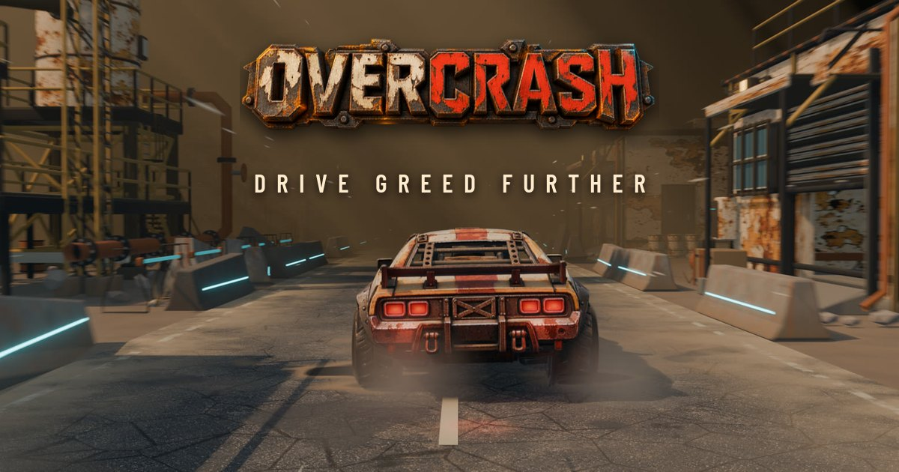

# OverCrash — playable demo

A car-themed **crash game** that runs entirely in the browser. One question drives the whole game: **"keep going a little longer, or cash out now?"**

> **Demo only. Fictional money, no real bets.** Built as a product design and game logic study.

**[▶ Play the demo](https://cbitran.github.io/overcrash-demo/)**

## The idea

A car accelerates down a straight track while the multiplier climbs. Cash out before it fails and you keep the win; fail first and you lose the stake. The outcome is drawn at launch, failure can come at 1.00×, and nothing warns the player. Visual scares (smoke, wear, turbo) are deliberately false signals.

## What's inside

- **Game engine** with rules covered by **24 automated tests**.
- **Operator configuration:** currency, locale, stake chips, default stake, house edge, max multiplier, auto cash-out and round history.
- **Responsible-gaming tools:** session loss limit, reality-check reminders that block the next round until confirmed, player pause, and an external operator lock.
- **Clear demo labelling** and an in-game rules window.
- **HUD and visual direction:** comic-book / cel-shaded art, designed in Figma.

## My role

Art direction, product design and UI by **Celio Bitran** (Design Manager / Head of UX/UI). Built with AI agents: art, animation and Figma assets with Codex, game logic and tests with Claude.

## Run locally

Open `index.html` in a browser. No server or build step.

## Status

Playable demo. A real-money version would need a server-side engine, wallet integration and regulatory review, none of which are part of this repository.

---
Design: [LinkedIn](https://linkedin.com/in/bitran) · [Behance](https://behance.net/bitran)
